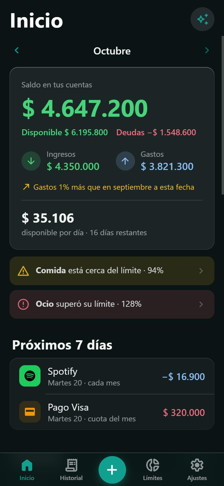
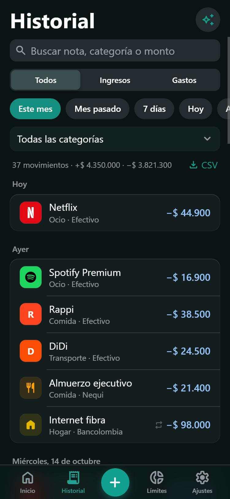
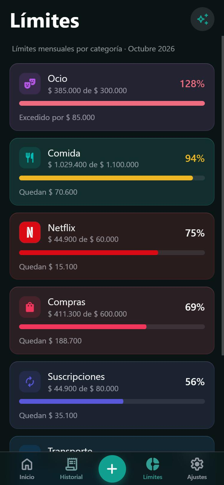
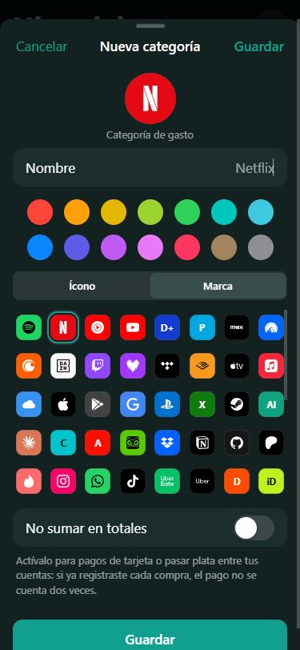

# FinanFlow

**Tu plata, clara y en tu bolsillo.** FinanFlow es una app gratuita para llevar tus gastos, ingresos, cuentas y tarjetas sin complicarte: anotas un gasto en dos toques y en un vistazo sabes cuánto tienes, cuánto debes y cuánto puedes gastar al día lo que queda del mes.

> **Versión:** 0.11.0 · Android y web (iPhone como app web) · En español · Sin anuncios · Funciona sin conexión

<p align="center">
  
  
  
  
</p>

## Descargar

- **Android:** descarga `FinanFlow-<versión>.apk` desde la [última versión](https://github.com/SantiagoCastrillonA/finanFlow/releases/latest), ábrelo en el celular y permite "instalar apps desconocidas" la primera vez. Para actualizar, instala el APK nuevo encima: tus datos se conservan. Desde la 0.10.3 la app te avisa en Inicio cuando hay una versión nueva (y en Ajustes puedes **Buscar actualizaciones**).
  - **Si Google Play Protect dice "Se bloqueó la app para proteger tu dispositivo":** pasa porque FinanFlow pide el *acceso a notificaciones* (para detectar tus pagos) y no viene de Play Store. Instálala por cable desde un computador: activa *Opciones de desarrollador → Depuración por USB*, conecta el teléfono y ejecuta `adb install -r FinanFlow-<versión>.apk`. La instalación por USB no se bloquea.
  - Si instalaste FinanFlow desde Android Studio (versión de depuración), no le instales el APK encima: tienen firmas distintas y Android pide desinstalar, lo que borra los datos que no estén respaldados.
- **iPhone o computador:** abre [finanflow-32cae.web.app](https://finanflow-32cae.web.app). En el iPhone, desde Safari: **Compartir → Agregar a inicio**.

## ¿Para qué sirve?

- **Saber en qué se te va la plata.** Cada gasto queda con su categoría (y el logo de la marca: Netflix, Rappi, Uber, D1…). La dona y el resumen del año muestran dónde más gastas.
- **No pasarte del presupuesto.** Pones un límite por categoría y la app te avisa al 80% y al 100%; en Inicio ves cuánto puedes gastar al día el resto del mes.
- **Tener tus cuentas y tarjetas al día.** Efectivo, banco, Nequi y tarjetas de crédito con su saldo o deuda, la cuota del mes y un aviso antes de la fecha de pago.
- **Registrar sin escribir (Android).** Cuando pagas con Google Wallet, Nu, Rappi, Davivienda o Nequi, aparece una tarjeta con el comercio y el monto: un toque y queda guardado.
- **Llevar los gastos de la casa en pareja.** Un espacio "Hogar" compartido, separado de tus gastos personales, que dice quién pagó y quién le debe a quién.
- **Ahorrar para algo.** Metas con cuánto llevas, cuánto falta y cuánto apartar al mes.

**Tus datos son tuyos:** se guardan en tu teléfono. La sincronización con tu cuenta de Google es opcional, y el texto de las notificaciones que lee la app nunca sale del celular.

---

## Características principales

### Registro en segundos
- **Agregar en dos toques:** monto → categoría (cuadrícula con íconos) → Guardar. La app recuerda la última categoría y método usados.
- **Categorías propias:** crea las tuyas (nombre, ícono o logo de marca, y color) desde la casilla **Nueva** o en Ajustes → Categorías. Las marcadas **"No sumar en totales"** (p. ej. el pago de la tarjeta de crédito) no cuentan como gasto ni ingreso.
- **Monto con separador de miles** mientras escribes (`3.200.000`).
- **Movimientos recurrentes:** repite un ingreso, gasto o transferencia cada mes, cada quincena (15 y fin de mes) o cada semana (salario, arriendo, suscripciones, ahorro) y se crea solo.
- **Próximos 7 días:** en Inicio, los recurrentes que vienen y los pagos de tarjeta pendientes.
- **Ocultar categorías** de la app que no uses o cambiarles el color (Ajustes → Categorías).
- **Logos de marcas:** si la nota o el comercio dice Netflix, Spotify, Rappi, Uber, D1, Claro… la fila muestra su logo (77 marcas, guardadas en el teléfono; sin conexión).
- **Límites con color:** cada tarjeta lleva el color de su categoría; ámbar cerca del límite y rojo al superarlo.
- **Editar y borrar estilo iOS:** toca un movimiento para editarlo; al borrarlo puedes **Deshacer**.

### Cuentas, tarjetas y metas
- **Cuentas y tarjetas** (Ajustes → Cuentas y tarjetas): activa Efectivo, tu banco o tu tarjeta de crédito con su saldo o deuda actual, o crea las tuyas. Cada movimiento indica de qué cuenta salió.
- **Tarjeta de crédito:** cuánto debes, cupo usado y fecha de pago, con aviso 3 días antes (Android). Con **Cuota del mes**, Próximos 7 días y el aviso muestran lo que te toca pagar (y lo que falta si ya abonaste).
- **Colores claros:** lo disponible en verde y las deudas en rojo, con el desglose "Disponible · Deudas" bajo el saldo. Todas las cuentas, también las de la app, se pueden renombrar.
- **Transferir:** mover dinero entre cuentas (p. ej. pagar la tarjeta desde el banco). No cuenta como gasto ni ingreso.
- **Metas de ahorro:** cuánto llevas, cuánto falta y cuánto apartar al mes para llegar a tiempo. Se aporta transfiriendo a la meta; en el Hogar las metas son compartidas.

### Inicio
- **Saldo** y **ingresos / gastos del mes**, con navegación entre meses (‹ ›).
- **Comparativa mensual:** "Gastos 12% menos que en septiembre a esta fecha".
- **Disponible por día:** cuánto puedes gastar al día el resto del mes según tus límites.
- **Gráfico de dona** (Balance, Gastos, Ingresos): toca una categoría para ver sus movimientos.
- **Resumen del año:** ingresos y gastos de los últimos 12 meses, promedio mensual, dónde más gastaste y qué subió este mes.
- **Tendencia** del saldo de los últimos 7 días.

### Límites
- **Límites mensuales por categoría** con barra de progreso y alertas al 80% y al 100%.

### Notificaciones (Android)
- **Recordatorio diario** a la hora que elijas (no suena si ya registraste algo ese día).
- **Alertas de límites** al llegar al 80% y al 100% (una vez por categoría y mes).
- **Resumen semanal** cada domingo.

### Detectar pagos (Android)
- **Al pagar con Google Wallet** (o al llegar un aviso de Nu, Rappi, Davivienda o Nequi) baja desde arriba una tarjeta de vidrio con el comercio, el monto y la categoría: **Registrar** o **Ignorar** con un toque.
- La primera vez con una tarjeta pregunta qué cuenta es y lo recuerda; también aprende la categoría de cada comercio.
- Pagos de tarjeta y dinero que te envías a ti mismo se registran como **transferencias**. Si dos apps avisan el mismo pago, cuenta uno solo.
- Lo que no confirmes queda en **Por confirmar** en Inicio. Nada se registra sin tu toque y el texto de los avisos no sale del celular.
- Se activa en Ajustes → Detectar pagos (permisos "Acceso a notificaciones" y "Mostrar sobre otras apps").

### Widget y accesos rápidos (Android)
- **Widget de pantalla de inicio:** saldo, ingresos y gastos del mes, y un botón **+** para agregar un gasto.
- **App Shortcuts:** mantén presionado el ícono para Agregar gasto, Ver balance o Ver historial.

### Hogar compartido (en pareja)
- **Personal + Hogar:** tus gastos personales siguen siendo privados; el Hogar es un espacio común que ambos editan. Cambias de espacio con el selector bajo el título.
- **Quién pagó y división:** cada gasto del Hogar indica quién pagó y cómo se divide (50/50, sin dividir, todo del otro o un porcentaje). El Inicio muestra quién le debe a quién y permite **Saldar cuentas**.
- **Pagado con tu cuenta:** en un gasto del Hogar que pagaste, elige en **"Salió de"** tu cuenta personal: baja su saldo sin contarse como gasto personal (en tu Historial se ve en gris como "Hogar").
- **Mover:** al editar un movimiento, **"Mover al Hogar"** o **"Mover a Personal"** lo pasa de espacio sin descuadrar tus cuentas.
- **Actividad:** la campanita muestra lo que registró, editó o borró tu pareja.
- **Invitación:** Ajustes → Hogar compartido → Crear un Hogar → compartir el código de 6 caracteres (vale 48 h, un solo uso).
- Requiere iniciar sesión con Google en ambos teléfonos.

### Personalización
- **Tema Automático / Claro / Oscuro.**
- **Monedas:** COP, USD, EUR, MXN, ARS, CLP y PEN.

### Inteligencia Artificial (opcional)
- **FinanBot:** asistente con [Google Gemini](https://aistudio.google.com/app/apikey) que conoce tus números del mes y da consejos de ahorro. Se activa pegando tu API Key en Ajustes.

### Sincronización y respaldo
- **Google Cloud Firebase** (opcional) o **modo local** sin cuenta.
- **Exportar JSON / CSV** (también solo lo filtrado en el Historial, p. ej. un rango de fechas) y **restaurar respaldo** (con validación del archivo). En Android el archivo se abre en la hoja de compartir (Drive, correo, WhatsApp…).

---

## Para desarrolladores

### 1. Desarrollo web
```bash
npm install
npm run dev
```
Abre `http://localhost:5173`.

### 2. Android nativo
```bash
npm install
npx cap sync
npx cap open android
```
En Android Studio, conecta tu celular con **Depuración USB** activada y presiona **Run app** (▶).

---

### APK firmado (instalar sin Android Studio, gratis)
Se hace una sola vez:

1. Crear la llave de firma **fuera del proyecto**. Pide una contraseña: guárdala bien.
   ```bash
   "C:\Program Files\Android\Android Studio\jbr\bin\keytool" -genkeypair -v -keystore "%USERPROFILE%\finanflow-release.jks" -alias finanflow -keyalg RSA -keysize 2048 -validity 10000
   ```
2. Crear `android/keystore.properties` (está en `.gitignore`, nunca se sube):
   ```properties
   storeFile=C:/Users/TU_USUARIO/finanflow-release.jks
   storePassword=tu-contraseña
   keyAlias=finanflow
   keyPassword=tu-contraseña
   ```
3. Copiar la huella **SHA-1** de la llave:
   ```bash
   "C:\Program Files\Android\Android Studio\jbr\bin\keytool" -list -v -keystore "%USERPROFILE%\finanflow-release.jks" -alias finanflow
   ```
4. Agregarla en Firebase Console → Configuración del proyecto → app Android → **Agregar huella digital**. Luego descargar de nuevo `google-services.json` en `android/app/`. Sin esto, el login con Google falla en el APK.
5. **Guardar una copia de la llave** (`finanflow-release.jks`) y de su contraseña, por ejemplo en Drive. Sin ella no se puede actualizar la app instalada.

Cada versión nueva: subir `versionCode` en `android/app/build.gradle` y ejecutar
```bash
npm run apk
```
Queda `FinanFlow-<versión>.apk` en la carpeta del proyecto. Pásalo al celular e instálalo.

### 3. Publicar la web (para iPhone) y las reglas de seguridad
```bash
npm run firebase-login
npm run deploy
```
La app queda en `https://finanflow-32cae.web.app`. En el iPhone: abrir el enlace en **Safari** → botón **Compartir** → **Agregar a inicio** → abrir FinanFlow desde el ícono → Ajustes → Nube → Conectar.

En la web instalada del iPhone no hay widget, recordatorios locales ni vibración (son funciones de la app de Android).

---

## Arquitectura técnica

Tecnologías web sin frameworks ni bundler:

- **Frontend:** Vanilla JS (un único script clásico `www/app.js`), HTML5, CSS3
- **Gráficos:** [Chart.js](https://www.chartjs.org/) 4, incluido localmente en `www/vendor/` para funcionar sin conexión
- **Backend/Sync:** [Firebase](https://firebase.google.com/) (Auth + Firestore)
- **IA:** [Google Gemini API](https://aistudio.google.com/app/apikey)
- **Mobile Wrapper:** [Capacitor](https://capacitorjs.com/) 5 con `@capacitor/app`, `@capacitor/haptics`, `@capacitor/local-notifications`, `@capacitor/filesystem`, `@capacitor/share` y `@capacitor-firebase/authentication` (login de Google nativo)
- **Widget Android:** `BalanceWidgetProvider` + plugin local `WidgetBridge` (Java)
- **PWA:** Service Worker + Manifest

---

## Configuración del desarrollador

### Activar Firebase (Sincronización en la nube)
1. Crea un proyecto en [Firebase Console](https://console.firebase.google.com/).
2. Agrega una app Web y copia las credenciales.
3. Pégalas en `www/app.js` reemplazando `FIREBASE_CONFIG`.
4. Activa **Firestore Database** y **Authentication** (método Google).
5. **Android:** Google bloquea el login dentro del WebView, así que la app usa Google Sign-In nativo. Agrega una app Android con el paquete `com.finanflow.app`, registra la huella SHA-1 (`cd android && ./gradlew signingReport`; la de debug y la de la llave de release son distintas) y descarga `google-services.json` en `android/app/`. **Sin ese archivo la app Android se cierra al abrir.**

### Activar FinanBot (Asistente de IA)
1. Obtén una API Key gratuita en [Google AI Studio](https://aistudio.google.com/app/apikey).
2. Pégala en **Ajustes → FinanBot** dentro de la app (se guarda solo en el dispositivo).

---

## Roadmap

- [x] App Shortcuts nativos de Android
- [x] Comparativa mensual
- [x] Recordatorios y alertas
- [x] Widget de pantalla de inicio
- [x] Movimientos recurrentes
- [x] Categorías personalizadas
- [x] Varias cuentas / billeteras
- [x] Metas de ahorro
- [ ] Soporte para adjuntar fotos de recibos
- [ ] Exportación a PDF

---

## Licencia

MIT - Libre para usar, modificar y distribuir.

---

*Tus datos son tuyos.*
